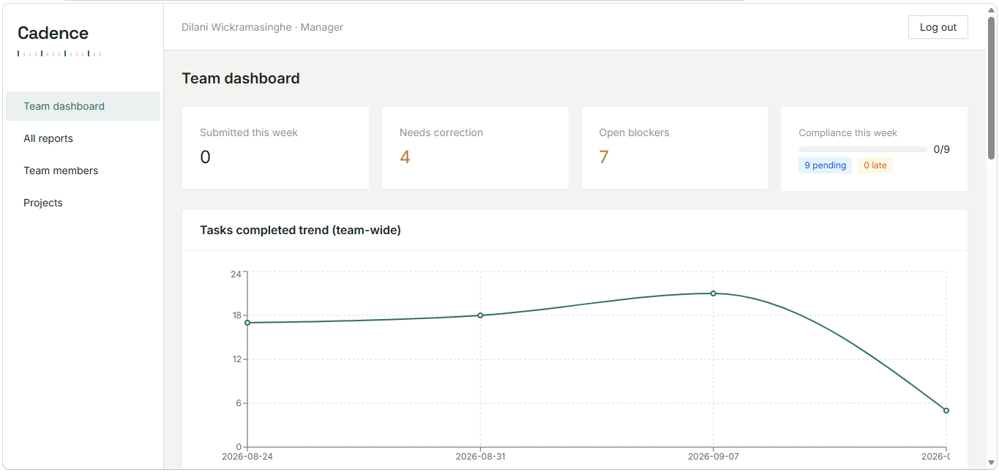
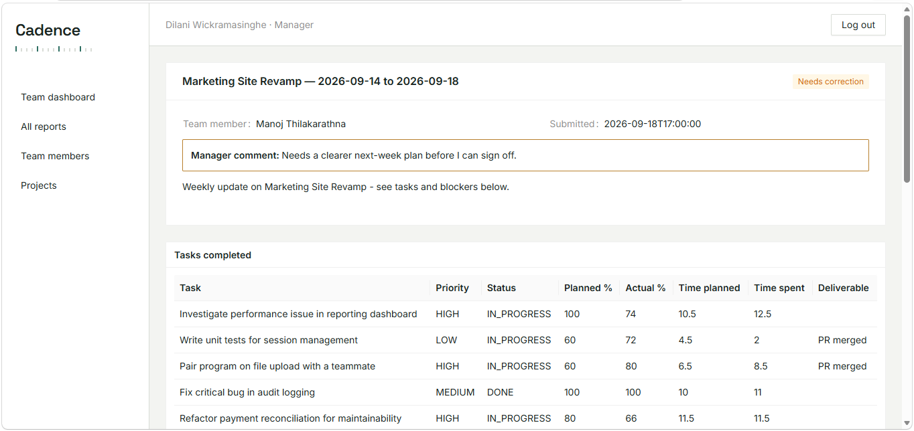
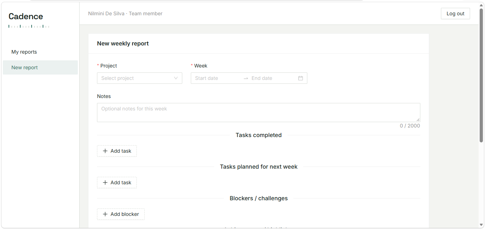
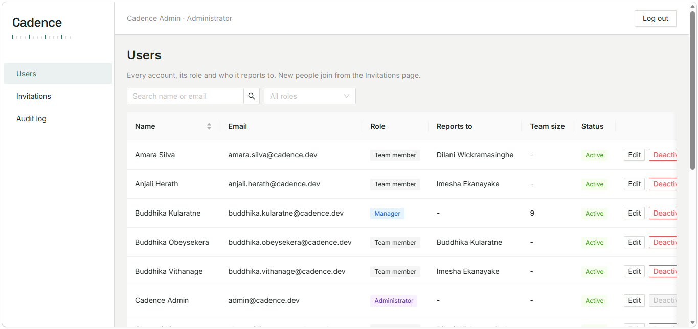
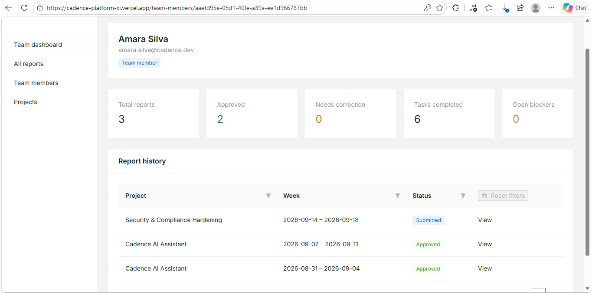

# Cadence

**Weekly reports for teams, without the spreadsheet chasing.** Team members write and submit a structured weekly report. Their manager reviews it, approves it or sends it back with a comment, and sees team workload and progress on a live dashboard.

[**Live demo**](https://cadence-platform-xi.vercel.app) · React 19 + TypeScript · Spring Boot (Java 21) · PostgreSQL

<!--   -->

<table>
  <tr>
    <td width="50%"><br><sub>Managers approve a report or request changes with a comment</sub></td>
    <td width="50%"><br><sub>Structured weekly report: tasks, time, achievements, blockers, next week</sub></td>
  </tr>
  <tr>
    <td width="50%"><br><sub>Administrators invite people and manage roles and managers</sub></td>
    <td width="50%"><br><sub>Per-member profile and stats for their manager</sub></td>
  </tr>
</table>

## What it does

| Role | Can do |
| --- | --- |
| **Team member** | Draft, submit and revise weekly reports, and read the manager's feedback |
| **Manager** | Review reports from their own direct reports, manage projects, and track team analytics |
| **Administrator** | Invite people, set roles and managers, deactivate accounts, and read the audit log. Cannot read report content |

## Highlights

- **Review workflow with history.** A report moves `DRAFT → SUBMITTED → APPROVED`, or to `NEEDS_CORRECTION` when a manager asks for changes. Every submission is saved as a snapshot, so the full revision history is kept.
- **Access scoped in the backend.** A manager only ever sees their own direct reports, in lists, profiles and every dashboard figure. Administrators manage accounts but cannot read report content.
- **Invite-only accounts.** There is no public sign-up. Invitations use single-use links that expire after 48 hours, and only a hash of the token is stored.
- **Secure sessions.** The JWT lives in an HTTP-only cookie, state-changing requests are CSRF-protected, passwords are BCrypt-hashed, and repeated failed logins lock the account temporarily.
- **Audit trail.** Sign-ins, invitations, account changes and review decisions are recorded and visible to administrators.
- **Manager analytics.** Task trends, workload by project, hours by task type, and status by team member, built with Recharts.
- **Server-side filtering.** Report lists are filtered, sorted and paginated in the database using Querydsl.
- **Schema as code.** Flyway owns the database schema, and a seed of 30 users, 9 projects and 90 reports gives a realistic demo on first start.
- **Tested access rules.** Unit tests cover report ownership, manager scoping, the password policy and login throttling.

## Architecture

```text
React SPA (Vite, Ant Design, React Query)
        │  REST + HTTP-only JWT cookie + CSRF header
        ▼
Spring Boot API:  controller → service → repository   (DTOs only leave the service layer)
        │
        ▼
PostgreSQL (Flyway migrations)
```

Deployed with the frontend on Vercel, the API on Render and the database on Supabase.

## Run locally

Needs Node.js 20+, JDK 21 and PostgreSQL (or Docker).

```bash
# 1. Database
docker run --name cadence-postgres -e POSTGRES_DB=weekly_report_db \
  -e POSTGRES_PASSWORD=change-me -p 5432:5432 -d postgres:17

# 2. Backend on :8080 (copy the secrets template and fill in DB_URL, DB_PASSWORD, JWT_SECRET)
cd platform/backend
cp src/main/resources/application-secrets.properties.example \
   src/main/resources/application-secrets.properties
./mvnw spring-boot:run

# 3. Frontend on :5173
cd platform/frontend && npm ci && npm run dev
```

Demo accounts (password `Password123!`, local demo data only):

| Role | Email |
| --- | --- |
| Administrator | `admin@cadence.dev` |
| Manager | `dilani.wickramasinghe@cadence.dev` |
| Team member | `amara.silva@cadence.dev` |

In development no email is sent. Invitation links are printed in the backend log.

## More

[Backend notes](platform/backend/README.md) · [Frontend notes](platform/frontend/README.md) · [License](LICENSE)
