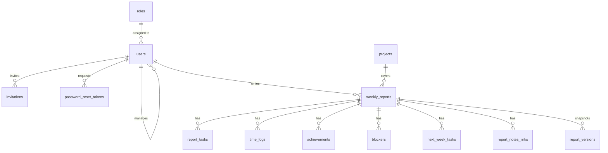

# Cadence Backend

Spring Boot REST API for Cadence. It handles authentication, the weekly-report workflow, projects and dashboard analytics.

**Stack:** Java 21 · Spring Boot (Web MVC, Validation) · Spring Data JPA + Querydsl · PostgreSQL · Flyway · Spring Security + JWT (jjwt) · Maven

## Run

```bash
cp src/main/resources/application-secrets.properties.example \
   src/main/resources/application-secrets.properties   # fill in DB_URL, DB_PASSWORD, JWT_SECRET
./mvnw spring-boot:run                                  # http://localhost:8080, health: GET /api/health
```

Needs JDK 21 and an empty PostgreSQL database. Flyway creates the schema and a demo dataset is loaded on first start.

| Variable | Purpose |
| --- | --- |
| `DB_URL`, `DB_USERNAME`, `DB_PASSWORD` | Database connection |
| `JWT_SECRET` | Base64 signing key, generate with `openssl rand -base64 48` |
| `APP_JWT_COOKIE_SECURE` | `false` over local HTTP, `true` over HTTPS |
| `APP_FRONTEND_URL` | Frontend URL used in emailed links |
| `APP_MAIL_ENABLED` | `false` logs emails instead of sending (default). `true` sends via SMTP or the Gmail API |
| `APP_SEED_DEMO_DATA` | Set `false` in real deployments |
| `BOOTSTRAP_ADMIN_EMAIL`, `_NAME`, `_PASSWORD` | Creates the first administrator when none exists |

## Design

```text
controller → service → repository     DTOs only leave the service layer
```

- **Access control.** Role checks use `@PreAuthorize`, and `ReportAccessService` decides who can view, edit or review a report. Managers are limited to their direct reports, and administrators cannot read report content.
- **Sessions.** JWT in an HTTP-only cookie, CSRF token on state-changing requests, BCrypt passwords. Deactivating a user takes effect on their next request.
- **Accounts.** Invite-only. Invitation and password-reset links are single-use and expire (48 hours and 30 minutes), and only a hash of each token is stored.
- **Abuse protection.** Five failed logins for one email within 15 minutes lock that email for 15 minutes, with a looser per-IP limit. Login errors never reveal whether an account exists.
- **Reports.** `DRAFT → SUBMITTED → APPROVED`, or `NEEDS_CORRECTION` when changes are requested. Each submission stores a JSON snapshot in `report_versions`.
- **Email.** `MailService` logs, sends by SMTP, or uses the Gmail API over HTTPS for hosts that block SMTP ports.

## API

All routes are under `/api`. Everything except `/auth/**` and `/health` requires sign-in.

| Area | Routes | Who |
| --- | --- | --- |
| Auth | login, logout, current user, accept invitation, forgot and reset password | Public, `me` needs sign-in |
| Reports | create, update, submit, history, detail, versions, list team reports | Team member, manager |
| Review | approve or request changes, edit a comment within 15 minutes | The author's manager |
| Projects | list, create, update, delete | Manager (list: anyone signed in) |
| Users | list direct reports, member profile | Manager |
| Dashboard | summary, tasks trend, status by member, workload by project, time by task type, recent activity, team overview, member stats | Manager, own team only |
| Admin | users, invitations, audit log | Administrator |

## Database

PostgreSQL with UUID keys. The schema is managed by Flyway migrations in `src/main/resources/db/migration/`. Add a new `V<n>__description.sql` for changes and never edit an applied migration.



## Test and build

```bash
./mvnw test      # access rules, password policy, login throttling, token and mail client tests
./mvnw package   # target/*.jar
```

A multi-stage `Dockerfile` builds on JDK 21 and runs on a JRE 21 image (port 8080). For production, use a random `JWT_SECRET`, set `APP_JWT_COOKIE_SECURE=true`, add the frontend origin to the CORS list in `SecurityConfig`, and turn demo data off.

## Common problems

| Symptom | Cause |
| --- | --- |
| Startup fails on `DB_URL` or `JWT_SECRET` | Secrets file missing or incomplete |
| Schema validation error | Database was not created by Flyway, use an empty one |
| Login works, next request is 401 | Cookie not stored, check `APP_JWT_COOKIE_SECURE` and the CORS origin list |
| 403 on POST, PUT, PATCH or DELETE | Missing CSRF header, which the frontend sends automatically |
