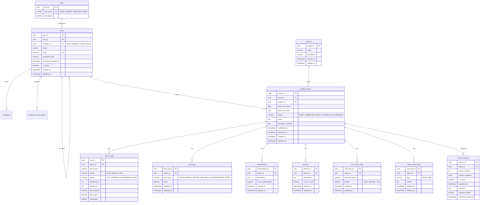

# Cadence Backend

Spring Boot REST API for the Cadence platform. Handles authentication, the weekly-report workflow, projects, and dashboard analytics.

## Contents

- [Tech stack](#tech-stack)
- [Getting started](#getting-started)
- [Configuration](#configuration)
- [Project structure](#project-structure)
- [Authentication and security](#authentication-and-security)
- [Report workflow](#report-workflow)
- [API reference](#api-reference)
- [Database](#database)
- [Demo data](#demo-data)
- [Testing and building](#testing-and-building)
- [Deployment](#deployment)
- [Troubleshooting](#troubleshooting)

## Tech stack

| Concern | Technology |
| --- | --- |
| Language / framework | Java 21, Spring Boot 4.1 (Web MVC, Validation) |
| Persistence | Spring Data JPA (Hibernate), PostgreSQL, Querydsl for filtered queries |
| Migrations | Flyway |
| Security | Spring Security, JWT (jjwt 0.12), BCrypt |
| Utilities | Lombok |
| Build | Maven (wrapper included) |

## Getting started

Requirements: JDK 21 and a running PostgreSQL database. No separate Maven install is needed.

1. Create the database, for example with Docker:

   ```bash
   docker run --name cadence-postgres -e POSTGRES_DB=weekly_report_db \
     -e POSTGRES_PASSWORD=change-me -p 5432:5432 -d postgres:17
   ```

   Or with a local install: `psql -U postgres -c "CREATE DATABASE weekly_report_db;"`

2. Create the local secrets file from the template (it is git-ignored):

   ```bash
   cp src/main/resources/application-secrets.properties.example \
      src/main/resources/application-secrets.properties
   ```

3. Fill in the values (see [Configuration](#configuration)), then start the API:

   ```bash
   ./mvnw spring-boot:run        # use mvnw.cmd on Windows
   ```

The API is available at `http://localhost:8080`. A quick check is `GET /api/health`.

## Configuration

Settings live in `src/main/resources/application.properties` and read their secrets from environment variables or from `application-secrets.properties`.

| Variable | Required | Description |
| --- | --- | --- |
| `DB_URL` | Yes | JDBC URL, e.g. `jdbc:postgresql://localhost:5432/weekly_report_db` |
| `DB_USERNAME` | No | Database user (defaults to `postgres`) |
| `DB_PASSWORD` | Yes | Database password |
| `JWT_SECRET` | Yes | Base64 secret used to sign login tokens. Use a long random value |
| `APP_JWT_COOKIE_SECURE` | Yes | `false` for local HTTP, `true` for HTTPS deployments (see below) |
| `APP_FRONTEND_URL` | No | Frontend base URL used in emailed links (default `http://localhost:5173`). Set it to the deployed frontend |
| `APP_MAIL_ENABLED` | No | `false` (default) logs emails instead of sending; `true` sends over SMTP (see [Email](#email)) |
| `APP_MAIL_FROM` | No | From address for outgoing email |
| `SPRING_MAIL_HOST`, `SPRING_MAIL_PORT`, `SPRING_MAIL_USERNAME`, `SPRING_MAIL_PASSWORD` | When mail is enabled | Standard Spring `spring.mail.*` SMTP settings |
| `APP_SEED_DEMO_DATA` | No | `true` (default) loads demo accounts and reports; set `false` for a real deployment |
| `BOOTSTRAP_ADMIN_EMAIL`, `BOOTSTRAP_ADMIN_NAME`, `BOOTSTRAP_ADMIN_PASSWORD` | No | Creates the first administrator at startup when none exists (password at least 10 characters) |

Other fixed settings in `application.properties`:

- Login tokens last 24 hours (`app.jwt.expiration-ms=86400000`).
- Invitation links last 48 hours and password reset links 30 minutes (`app.security.invite-ttl-hours`, `app.security.reset-ttl-minutes`).
- Five failed sign-ins for one email within 15 minutes lock that email for 15 minutes (`app.security.max-failed-logins`, `attempt-window-minutes`, `lockout-minutes`). A looser per-IP limit also applies.
- `server.forward-headers-strategy=native`, so the client IP used for rate limiting and the audit log comes from `X-Forwarded-For` when the request arrives through a trusted proxy such as Render.
- `spring.jpa.hibernate.ddl-auto=validate`, so the schema is owned entirely by Flyway.
- `spring.jpa.open-in-view=false`.

Generate a secret with `openssl rand -base64 48`.

## Project structure

```text
src/main/java/com/cadence/
├── controller/    HTTP endpoints and GlobalExceptionHandler
├── service/       Business logic (AuthService, InvitationService, PasswordResetService,
│                  AdminUserService, MailService, AuditService, LoginAttemptService,
│                  PasswordPolicy, ReportService, ReportAccessService, ProjectService,
│                  DashboardService)
├── repository/    Spring Data repositories, plus Querydsl implementations for
│                  filtered and paginated queries
├── entity/        JPA entities and enums
├── dto/           Request and response objects, grouped by feature
├── exception/     ApiException, FieldValidationException
├── util/          TokenUtil (one-time tokens, email normalising)
├── security/      SecurityConfig, JWT filter and service, cookie and CSRF handling
└── config/        DataSeeder, Querydsl config, seed-data models
src/main/resources/
├── db/migration/  Flyway migrations
└── seed-data/     Demo users, projects and reports (JSON)
```

Requests flow controller → service → repository. Controllers deal in DTOs only; entities do not leave the service layer.

## Authentication and security

**Login.** `POST /api/auth/login` validates credentials and sets an `auth_token` cookie containing a signed JWT. The cookie is `HttpOnly`, so JavaScript cannot read it. The API is stateless and keeps no server-side session.

**Cookie attributes depend on `APP_JWT_COOKIE_SECURE`.**

| Setting | `Secure` | `SameSite` | Use |
| --- | --- | --- | --- |
| `false` | No | `Lax` | Local development over HTTP |
| `true` | Yes | `None` | Deployed over HTTPS, with frontend and API on different domains |

Browsers reject `SameSite=None` without `Secure`, which is why both are controlled by one flag.

**CSRF.** Spring sets an `XSRF-TOKEN` cookie that the frontend echoes back in the `X-XSRF-TOKEN` header on state-changing requests. The pre-login endpoints (login, logout, accept invitation, forgot and reset password) are exempt because there is no session yet.

**CORS.** Allowed origins are an explicit list in `SecurityConfig.corsConfigurationSource()`: `http://localhost:5173` and the deployed frontend URL. Credentials are enabled, so `*` cannot be used. Add any new frontend origin there.

**Authorization.** Public endpoints are `/api/auth/**` and `/api/health`. All other `/api/**` routes require authentication, and everything else is denied. Method-level rules use `@PreAuthorize`:

- `hasRole('ADMIN')`, `hasRole('MANAGER')` or `hasRole('TEAM_MEMBER')` for role checks. `/api/admin/**` is also restricted to administrators in `SecurityConfig`.
- `ReportAccessService.isOwner` limits edit and submit to the report's author.
- `ReportAccessService.canView` allows the author, or a manager whose direct report the author is (never for a draft). Administrators cannot read report content.
- `ReportAccessService.canReview` limits review decisions and comment edits to the author's own manager.

Passwords are stored as BCrypt hashes.

### Accounts, roles and invitations

There is **no public registration**. Roles are never chosen by the person signing up.

- Roles: `ADMIN`, `MANAGER`, `TEAM_MEMBER`. Each team member has one direct manager (`users.manager_id`). A manager sees only their direct reports: reports, member lists, profiles and every dashboard figure are scoped by that link, in the backend queries and access checks.
- An administrator invites someone with an email, a role and (for team members) a manager. The emailed link holds a single-use token that expires after 48 hours. Only a SHA-256 hash of the token is stored. Opening the link, the invitee sets a name and password and is signed in; the role comes from the invitation, not from the form.
- Administrators can resend (new token and expiry, old link stops working) or revoke pending invitations, change roles and managers, and deactivate or reactivate accounts.
- Deactivation takes effect on the user's next request, because `JwtAuthFilter` checks the active flag every time. A manager who still has active team members, and the last active administrator, cannot be deactivated or demoted.
- Password reset: `POST /api/auth/forgot-password` always answers 204, whether or not the email has an account. The link is single use and expires after 30 minutes. A reset (like any password change) invalidates every session issued before it.
- Password rules (`PasswordPolicy`): 10 to 72 bytes, not a well-known password, not repetitive, not containing the person's email or name.
- Login protection: repeated failures lock the email (and, more loosely, the IP) temporarily. Wrong password, unknown email and deactivated account all return the same message.
- Audit log: sign-ins and failures, invitations, account changes, password resets and report review decisions are recorded in `audit_log` and shown to administrators.

The rate limiter is in memory, which suits a single instance. Running several instances would need it moved to a shared store such as Redis.

### Email

All email goes through `MailService`.

- `APP_MAIL_ENABLED=false` (default): the message, including the link, is written to the backend log. Use this locally.
- `APP_MAIL_ENABLED=true`: sent through Spring's `JavaMailSender`, configured with the standard `spring.mail.*` properties. Any SMTP provider works, for example Resend (`smtp.resend.com`, port 587, username `resend`, password your API key), Amazon SES, Brevo or Gmail. Set the values in `application-secrets.properties` or as environment variables.
- Some hosts block outbound SMTP ports. If sending fails in production, add an HTTP-API implementation inside `MailService.send`; nothing else depends on SMTP.

### First administrator

For a real deployment set `APP_SEED_DEMO_DATA=false` and the `BOOTSTRAP_ADMIN_*` variables. On startup, if no administrator exists, one is created from them. With demo data on, `admin@cadence.dev` is created instead.

## Report workflow

```text
            submit                    approve
  DRAFT ──────────────► SUBMITTED ──────────────► APPROVED
    ▲                       │
    │   edit + resubmit     │ request changes (comment required)
    └──── NEEDS_CORRECTION ◄┘
```

- A report can be edited or submitted only while it is `DRAFT` or `NEEDS_CORRECTION`.
- Each submission stores a **snapshot version** in `report_versions`, so the full revision history is kept.
- Only `SUBMITTED` reports can be reviewed. A manager either approves or requests changes. Requesting changes requires a comment.
- A manager can edit their comment for 15 minutes after posting it, and only while the report is `NEEDS_CORRECTION`. Edited comments are flagged.
- Invalid state changes are rejected and returned as errors by `GlobalExceptionHandler`. Validation failures come back as a field-to-message map.

## API reference

All routes are under `/api`. "Manager" and "Member" show the role required.

### Auth

| Method | Path | Access | Description |
| --- | --- | --- | --- |
| POST | `/auth/login` | Public | Sign in and set the auth cookie |
| POST | `/auth/logout` | Public | Clear the auth cookie |
| GET | `/auth/me` | Signed in | Current user |
| GET | `/auth/invitations/preview?token=` | Public | Email, role and manager for an invitation link (410 if invalid or expired) |
| POST | `/auth/accept-invite` | Public | Create the account from an invitation and sign in |
| POST | `/auth/forgot-password` | Public | Email a reset link (always 204) |
| POST | `/auth/reset-password` | Public | Set a new password with a reset token |

### Admin (administrator only)

| Method | Path | Description |
| --- | --- | --- |
| GET | `/admin/users` | All users with role, manager, team size, status |
| PATCH | `/admin/users/{id}` | Change name, role or manager |
| POST | `/admin/users/{id}/deactivate` | Deactivate (immediate lock-out) |
| POST | `/admin/users/{id}/reactivate` | Reactivate |
| GET | `/admin/invitations` | All invitations |
| POST | `/admin/invitations` | Invite by email, role and (team members) manager |
| POST | `/admin/invitations/{id}/resend` | Send a fresh link |
| DELETE | `/admin/invitations/{id}` | Revoke a pending invitation |
| GET | `/admin/audit-log` | Audit entries, filter by `action` and `actor`, paginated |

### Reports

| Method | Path | Access | Description |
| --- | --- | --- | --- |
| POST | `/reports` | Member | Create a draft |
| PUT | `/reports/{id}` | Owner | Update a draft or a report needing correction |
| POST | `/reports/{id}/submit` | Owner | Submit and snapshot a version |
| GET | `/reports/mine` | Member | Own report history (filter, sort, paginate) |
| GET | `/reports/{id}` | Owner or the author's manager | Report detail |
| GET | `/reports/{id}/versions` | Owner or the author's manager | Version history |
| GET | `/reports` | Manager | Reports from the manager's direct reports (filter, sort, paginate) |
| POST | `/reports/{id}/review` | Author's manager | Body `decision`: `APPROVE` or `REQUEST_CHANGES`, plus `comment` |
| PATCH | `/reports/{id}/comment` | Author's manager | Edit a comment within the edit window |

### Projects

| Method | Path | Access | Description |
| --- | --- | --- | --- |
| GET | `/projects` | Signed in | List projects |
| POST | `/projects` | Manager | Create a project |
| PUT | `/projects/{id}` | Manager | Update a project |
| DELETE | `/projects/{id}` | Manager | Delete a project |

### Users

| Method | Path | Access | Description |
| --- | --- | --- | --- |
| GET | `/users/team-members` | Manager | The manager's direct reports |
| GET | `/users/{id}` | Manager | Profile of a direct report (404 for anyone else) |

### Dashboard (manager only, own team)

| Method | Path | Description |
| --- | --- | --- |
| GET | `/dashboard/summary` | Headline totals |
| GET | `/dashboard/tasks-trend` | Task counts over time |
| GET | `/dashboard/status-by-member` | Report status breakdown per member |
| GET | `/dashboard/workload-by-project` | Workload per project |
| GET | `/dashboard/time-by-task-type` | Hours by task type |
| GET | `/dashboard/recent-activity` | Latest activity feed |
| GET | `/dashboard/team-overview` | Per-member overview |
| GET | `/dashboard/member-stats/{userId}` | Stats for one member |

### Health

`GET /api/health` is public and returns the service status.

## Database

PostgreSQL is the system of record and all IDs are UUIDs. The schema is created by Flyway from `src/main/resources/db/migration/` (`V1__initial_schema.sql`, then `V2__auth_overhaul.sql` for the ADMIN role, manager link, invitations, password reset tokens and audit log) the first time the app connects. Do not apply it by hand. Existing databases are upgraded by `V2` on the next start; the seeder then links the demo team members to their managers.



Foreign keys have no cascade deletes, so remove child rows before their parent during manual cleanup.

**Changing the schema.** Add a new `V2__description.sql` file. Never edit an applied migration, because Flyway checks its checksum.

## Demo data

On startup `DataSeeder` runs and:

- Creates the three roles if missing.
- Adds users and projects from `seed-data/*.json` if they do not exist, and links each demo team member to a manager (`managerEmail` in `users.json`).
- Adds the demo reports only when the database has no reports at all.
- Creates the bootstrap administrator when configured and no administrator exists.

All of the demo seeding is skipped when `APP_SEED_DEMO_DATA=false`.

Report dates are relative to the Monday the seeder runs on, so the data always looks current. All seeded accounts use the password `Password123!`. The seeded administrator is `admin@cadence.dev`. Seeded managers are `dilani.wickramasinghe@cadence.dev` (nine team members, including `amara.silva@cadence.dev`), `buddhika.kularatne@cadence.dev` (nine) and `imesha.ekanayake@cadence.dev` (eight).

Never deploy these accounts to a shared or production environment.

## Testing and building

```bash
./mvnw test             # run tests
./mvnw package          # build target/*.jar
./mvnw package -DskipTests
```

Tests live in `src/test/java/com/cadence`. They include `ReportAccessServiceTest` (ownership, manager scoping and admin exclusion), `PasswordPolicyTest`, `LoginAttemptServiceTest` and `TokenUtilTest`, plus `ApplicationTests`, a context-load test that needs a reachable database.

## Deployment

A multi-stage `Dockerfile` is included. It builds with Maven on JDK 21 and runs the jar on a JRE 21 image, exposing port 8080.

```bash
docker build -t cadence-backend .
docker run -p 8080:8080 \
  -e DB_URL=jdbc:postgresql://host:5432/weekly_report_db \
  -e DB_USERNAME=postgres \
  -e DB_PASSWORD=... \
  -e JWT_SECRET=... \
  -e APP_JWT_COOKIE_SECURE=true \
  cadence-backend
```

Production checklist:

- Use a unique, random `JWT_SECRET` and strong database credentials.
- Set `APP_JWT_COOKIE_SECURE=true` and serve over HTTPS.
- Add the frontend's exact origin to the CORS list in `SecurityConfig`.
- Do not load the demo users into a real environment.
- Let Flyway apply migrations on startup, or run them in your deployment pipeline.

## Troubleshooting

| Symptom | Likely cause |
| --- | --- |
| Fails at startup with a placeholder error for `DB_URL` or `JWT_SECRET` | `application-secrets.properties` is missing or incomplete |
| Schema validation error | The database has tables from outside Flyway. Use an empty database |
| Login works but the next request is 401 | Cookie not stored. Check `APP_JWT_COOKIE_SECURE` matches HTTP or HTTPS, and that the origin is in the CORS list |
| 403 on POST, PUT, PATCH, DELETE | Missing CSRF header. The frontend sends `X-XSRF-TOKEN` automatically |
| Browser reports a CORS error | Frontend origin is not in the allowed list |
